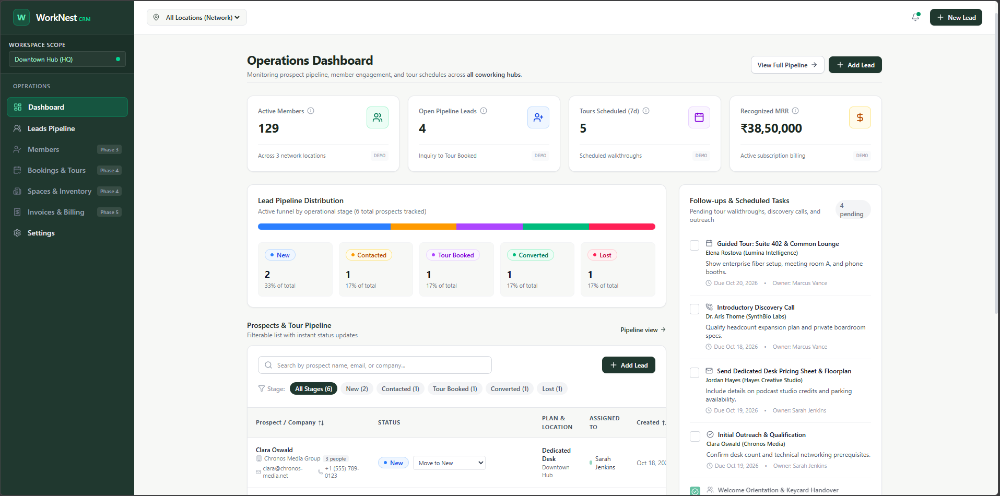

# WorkNest CRM




WorkNest CRM is a dedicated coworking management and prospect conversion system. It unifies the complete coworking member lifecycle into one operational cockpit:

$$\text{Inquiry} \longrightarrow \text{Qualification} \longrightarrow \text{Follow-up} \longrightarrow \text{Tour} \longrightarrow \text{Membership Conversion} \longrightarrow \text{Booking/Engagement} \longrightarrow \text{Renewal/Retention}$$

---

## Tech Stack

| Layer | Technology |
| :--- | :--- |
| **Frontend Framework** | [Next.js 16 (App Router)](https://nextjs.org/) with React 19 |
| **Language** | [TypeScript](https://www.typescriptlang.org/) (Strict Mode) |
| **Styling** | [Tailwind CSS v4](https://tailwindcss.com/) with WorkNest Design Tokens |
| **Icons** | [Lucide React](https://lucide.dev/) |
| **Backend Framework** | [FastAPI](https://fastapi.tiangolo.com/) with Python 3.12 |
| **API Validation** | [Pydantic v2](https://docs.pydantic.dev/) |
| **ORM** | [SQLAlchemy 2.0](https://www.sqlalchemy.org/) |
| **Migrations** | [Alembic](https://alembic.sqlalchemy.org/) |
| **Database** | SQLite (dev) / PostgreSQL (production) |
| **Frontend Tests** | [Vitest](https://vitest.dev/) + `@testing-library/react` |
| **Backend Tests** | [pytest](https://pytest.org/) + `httpx` TestClient |
| **Code Quality** | ESLint 9 (`eslint-config-next`) |

---

## Project Structure

```text
WorkNest/
├── src/                             # Next.js App Router frontend
│   ├── app/                         # Routes and layouts
│   │   ├── layout.tsx
│   │   ├── page.tsx                 # Operations Dashboard
│   │   ├── leads/page.tsx
│   │   ├── members/page.tsx
│   │   ├── spaces/page.tsx
│   │   ├── bookings/page.tsx
│   │   ├── billing/page.tsx
│   │   └── settings/page.tsx
│   ├── components/
│   │   ├── layout/                  # AppShell, Header, Sidebar, Notifications
│   │   └── ui/                      # StatusBadge and shared primitives
│   ├── context/
│   │   └── WorkNestContext.tsx       # Client state store & localStorage sync
│   ├── features/                    # Domain feature modules
│   │   ├── dashboard/
│   │   ├── leads/
│   │   ├── members/
│   │   ├── spaces/
│   │   ├── bookings/
│   │   ├── billing/
│   │   └── settings/
│   ├── lib/
│   │   ├── mock-data.ts             # Demo fixtures for offline/frontend mode
│   │   └── utils.ts
│   └── types/
│       └── index.ts                 # Shared domain models
│
├── server/                          # Python / FastAPI backend
│   ├── app/
│   │   ├── main.py                  # FastAPI app entrypoint (CORS, lifespan)
│   │   ├── config.py                # Pydantic BaseSettings
│   │   ├── core/
│   │   │   ├── security.py          # JWT & bcrypt
│   │   │   └── dependencies.py      # Auth & DB session injectors
│   │   ├── db/
│   │   │   ├── base.py              # DeclarativeBase + TimestampMixin
│   │   │   ├── session.py           # Engine & SessionLocal
│   │   │   └── seed.py              # Fixture seeder
│   │   ├── models/                  # SQLAlchemy 2.0 ORM models
│   │   │   ├── organization.py      # Organization, Location, StaffMember
│   │   │   ├── lead.py              # Lead, LeadAuditLog, Activity
│   │   │   ├── member.py            # Member, MembershipPlan, Membership
│   │   │   ├── space.py             # Space, Booking
│   │   │   └── invoice.py           # Invoice, InvoiceLineItem, PaymentRecord
│   │   ├── schemas/                 # Pydantic v2 request/response schemas
│   │   ├── services/                # Authoritative domain business logic
│   │   │   ├── lead_service.py      # Duplicate check, lost-reason enforcement, conversion
│   │   │   ├── booking_service.py   # Concurrency-safe conflict prevention
│   │   │   ├── billing_service.py   # GST calc, payment reconciliation
│   │   │   └── dashboard_service.py # Live KPI metrics & operational alerts
│   │   └── api/v1/                  # REST API route handlers
│   │       ├── auth.py
│   │       ├── leads.py
│   │       ├── activities.py
│   │       ├── members.py
│   │       ├── spaces.py
│   │       ├── bookings.py
│   │       ├── invoices.py
│   │       ├── settings.py
│   │       ├── dashboard.py
│   │       └── router.py
│   ├── tests/
│   │   ├── conftest.py              # In-memory test DB + TestClient fixtures
│   │   ├── test_leads.py
│   │   ├── test_bookings.py
│   │   ├── test_billing.py
│   │   └── test_dashboard.py
│   ├── alembic/                     # Database migrations
│   ├── alembic.ini
│   ├── pyproject.toml
│   ├── requirements.txt
│   └── .env.example
│
├── public/
├── .env.example                     # Frontend env template (NEXT_PUBLIC_API_URL)
├── .github/
│   └── dependabot.yml               # Auto-updates: npm + pip + github-actions
├── AGENTS.md
└── prd.md
```

---

## Getting Started

### Prerequisites

- **Node.js** `v20+` — Tested on `v24.16`
- **pnpm** `v9+` — Tested on `v12.3.4`
- **Python** `3.12+`
- **uv** — Recommended Python package manager (`pip install uv`)

---

### Frontend Setup

```bash
# Install dependencies
pnpm install

# Copy env file
cp .env.example .env.local
# Set NEXT_PUBLIC_API_URL=http://localhost:8000/api/v1

# Start dev server
pnpm dev
```

Open [http://localhost:3000](http://localhost:3000).

---

### Backend Setup

```bash
cd server

# Create and activate virtual environment
uv venv --prompt .venv
source .venv/Scripts/activate   # Windows (Git Bash)
# source .venv/bin/activate      # macOS/Linux

# Install dependencies
uv pip install -e ".[dev]"

# Copy and configure environment
cp .env.example .env
# Edit .env if needed (DATABASE_URL defaults to SQLite)

# Run Alembic migrations
alembic upgrade head

# Seed the database with demo data
python -m app.db.seed

# Start the API server
uvicorn app.main:app --reload --port 8000
```

API will be live at [http://localhost:8000](http://localhost:8000).  
Interactive docs at [http://localhost:8000/docs](http://localhost:8000/docs).

**Default dev credentials** (seeded automatically):

| Name | Email | Password | Role |
| :--- | :--- | :--- | :--- |
| Marcus Vance | `marcus@worknest.space` | `WorkNest123!` | Workspace Owner |
| Sarah Jenkins | `sarah@worknest.space` | `WorkNest123!` | Community Manager |
| Priya Nair | `priya@worknest.space` | `WorkNest123!` | Sales Lead |

---

## Available Scripts

### Frontend

| Command | Description |
| :--- | :--- |
| `pnpm dev` | Starts Next.js development server with hot-reload |
| `pnpm build` | Builds optimized production bundle |
| `pnpm start` | Starts production server |
| `pnpm lint` | Runs ESLint 9 checks |
| `pnpm typecheck` | Validates TypeScript across all modules |
| `pnpm test` | Runs frontend unit & component tests (Vitest) |

### Backend

| Command | Description |
| :--- | :--- |
| `uvicorn app.main:app --reload` | Start dev API server |
| `alembic upgrade head` | Apply all pending migrations |
| `alembic revision --autogenerate -m "..."` | Generate new migration |
| `python -m app.db.seed` | Seed database with demo fixtures |
| `pytest -v` | Run backend test suite |

---

## API Reference

All endpoints are prefixed with `/api/v1`. Interactive OpenAPI documentation is available at `/docs` when the backend is running.

| Module | Key Endpoints |
| :--- | :--- |
| **Auth** | `POST /auth/login`, `GET /auth/me` |
| **Leads** | `GET/POST /leads`, `PATCH /leads/{id}/status`, `POST /leads/{id}/convert` |
| **Activities** | `GET/POST /activities`, `PATCH /activities/{id}/toggle` |
| **Members** | `GET/POST /members`, `PATCH /members/memberships/{id}/status` |
| **Spaces** | `GET/POST /spaces`, `PATCH /spaces/{id}/toggle-active` |
| **Bookings** | `POST /bookings/check-conflict`, `GET/POST /bookings`, `POST /bookings/{id}/cancel` |
| **Invoices** | `GET/POST /invoices`, `POST /invoices/{id}/payments`, `POST /invoices/{id}/void` |
| **Settings** | `GET/PATCH /settings/organization`, CRUD for locations, plans, and staff |
| **Dashboard** | `GET /dashboard/metrics`, `GET /dashboard/notifications` |

---

## License

This project is licensed under the [MIT LICENSE](LICENSE).
